<div align="center">

  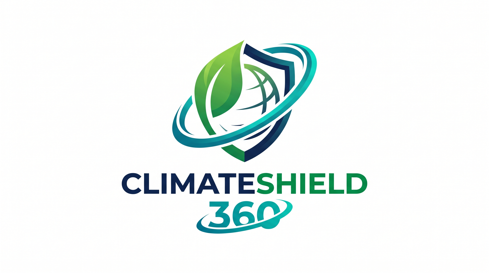

  # 🛡️ ClimateShield 360
  ### Karachi Extreme Weather & Crisis Platform
  **From 592,000+ Verified Observations to Operational Municipal Action**

  [](https://github.com)
  [](doc/Dataset_Declaration.md)
  [](backend/tests)
  [](doc/presentation/climateshield_360_karachi.mp4)
  [](doc/presentation/ClimateShield_360_Pitch.pptx)
  [](doc/MODEL_REPORT.md)
  [](pipeline/data/processed/climateshield.duckdb)
  [](doc/HOURLY_INGESTION_REPORT.md)
  [](Summary.pdf)
  [](LICENSE)

  <p align="center">
    <b>An end-to-end early warning and anticipatory emergency response system designed for Karachi municipal dispatchers, traffic wardens, and disaster relief authorities.</b>
  </p>

  <p align="center">
    <a href="#-quickstart-for-hackinsight-judges"><b>⚡ Judge Quickstart</b></a> •
    <a href="#-live-platform-walkthrough--video-demo"><b>🎬 Video Demo</b></a> •
    <a href="#-the-karachi-problem-statement"><b>🌊 The Problem</b></a> •
    <a href="#-system-architecture"><b>🏗️ Architecture</b></a> •
    <a href="#-interactive-ui-gallery"><b>📸 UI Gallery</b></a> •
    <a href="#-ml-modeling-vs-declared-baseline"><b>🤖 ML Benchmarks</b></a> •
    <a href="#-jury-evaluation-rubric--verifiable-evidence"><b>🎯 Scoring Rubric</b></a> •
    <a href="#-hackinsight-deliverables-compliance-matrix"><b>📋 Deliverables Matrix</b></a> •
    <a href="#-team-credentials"><b>👥 The Team</b></a>
  </p>

</div>

---

## 👥 The Team

Submitted for **HackInsight 2026: Data-to-Decision** (Climate & Infrastructure Analytics Track).

| Member | Role & Responsibilities | Key Deliverables Led |
|---|---|---|
| **Syed Muhammad Hunain** | AI Engineer, Machine Learning Specialist | Spatial 3D Risk Map, MapLibre GL Integration, FastAPI Architecture, Jury Presentation |
| **Muhammad Afzal** | Fullstack Developer, ML Specialist | DuckDB Columnar Warehouse, LightGBM Quantile Models, 24h Baseline Benchmarking, Ingestion Daemon |
| **Makshoof Kamal Jilani** | AI Fullstack Developer, ML Specialist | 8 Sectoral Impact Matrices, Emergency Action Planner, Responsible AI & Fairness Audit |

---

## The Working Link:
https://makshoof.github.io/ClimateShield-360/

## 🌊 The Karachi Problem Statement

Karachi, a coastal megacity of over 17 million people, faces recurring dual climate shocks: **lethal monsoon urban waterlogging** and **severe extreme heatwaves**. 

- **The Choke Points**: Monsoonal downpours quickly overwhelm neglected drainage nullahs (Lyari and Malir river basins), submerging underpasses, isolating industrial hubs (Korangi, SITE), and paralyzing arterial road corridors under 2 to 4 feet of water.
- **The Information Vacuum**: Traditional meteorological forecasts provide coarse regional summaries 24 hours too late. Municipal authorities and Traffic Police typically react only *after* commuter vehicles are submerged and arterial grids are locked.
- **The Solution**: **ClimateShield 360** bridges the data-to-decision gap by integrating upstream GloFAS river discharge, localized Open-Meteo precipitation, and OpenStreetMap infrastructure into a 4-tier **Road Inundation Risk Index**. This gives emergency dispatchers a **2 to 4-hour tactical advance window** to pre-deploy dewatering suction pumps and position traffic diversion cones before choke points submerge.

---

## 🏗️ System Architecture

ClimateShield 360 follows a strict **Truth-in-Data** architectural pipeline:

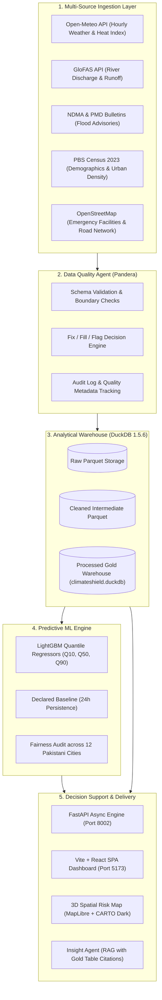

---

## 🎬 Live Platform Walkthrough & Video Demo

> [!TIP]
> **Complete End-to-End Walkthrough**: Watch the full live demonstration of ClimateShield 360 showcasing the 3D Spatial Risk Map, Heat & Monsoon Forecasting with Quantile Intervals, 8 Sectoral Impacts, Pandera Quality Agent triage, and Grounded Insight Assistant.

<div align="center">

  <video src="https://github.com/Afzal-Iqbal/climateshield-360/raw/main/doc/presentation/climateshield_360_karachi.mp4" controls="controls" width="100%" poster="doc/presentation/video_preview.png">
    <source src="doc/presentation/climateshield_360_karachi.mp4" type="video/mp4" />
    Your browser does not support the video tag.
  </video>

  <br/><br/>

  <a href="https://github.com/Afzal-Iqbal/climateshield-360/blob/main/doc/presentation/climateshield_360_karachi.mp4" title="Click to Watch the Full Video Walkthrough">
    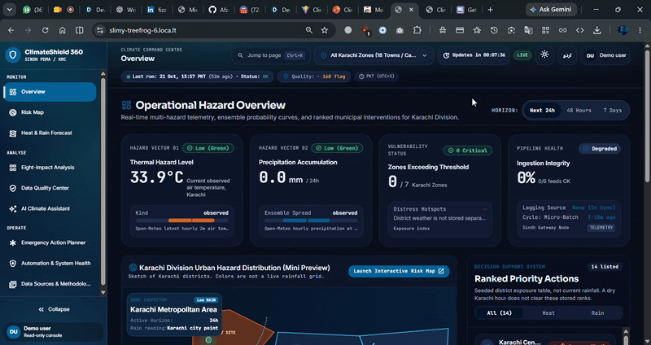
  </a>

  <br/><br/>

  <p align="center">
    <a href="doc/presentation/climateshield_360_karachi.mp4">
      
    </a>
    &nbsp;&nbsp;
    <a href="doc/presentation/ClimateShield_360_Pitch.pptx">
      
    </a>
    &nbsp;&nbsp;
    <a href="Summary.pdf">
      
    </a>
  </p>

</div>

---

## 📸 Interactive UI Gallery

The ClimateShield 360 interface was designed for high-stress municipal operations rooms, featuring an eye-friendly dark tactical theme, sub-second rendering, and real-time live telemetry.

### 1. Executive Overview Dashboard (`/`)
*Dual-hazard meteorological radar, active heatwave & rainfall alerts, citywide rainfall trajectory, and prioritized district action queue.*
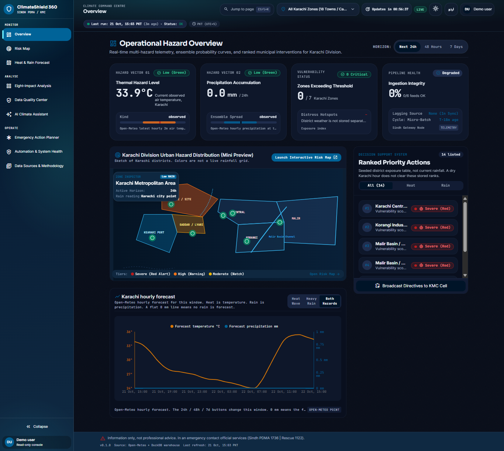

### 2. 3D Spatial Risk Map (`/risk-map`)
*3D extruded district polygons, 90% confidence interval bands, real-time flood inundation severity choropleths, critical infrastructure overlays (hospitals, schools, shelters, power substations, drainage culverts), and district dossier inspection.*
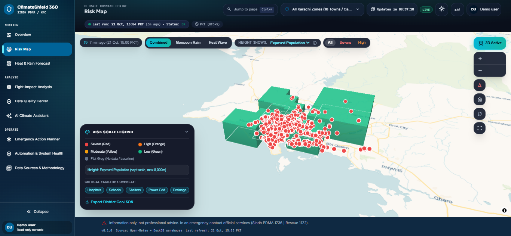

### 3. Heat & Monsoon Rainfall Forecast (`/forecast`)
*Multi-horizon (24h / 48h / 7d) observed vs. predicted precipitation curves with LightGBM quantile intervals ($Q_{10}$ to $Q_{90}$) and 24h baseline comparison.*
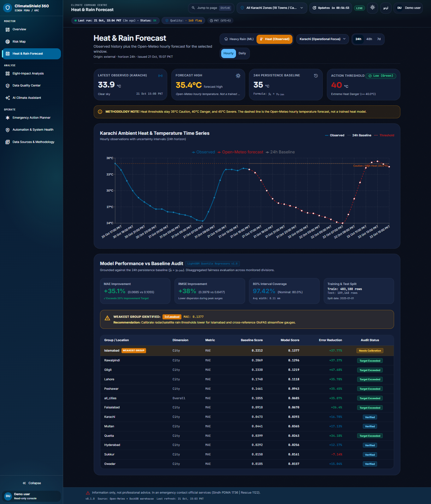

### 4. Eight-Sector Impact Matrix (`/eight-impacts`)
*Granular impact analysis across Physical, Environmental, Producers, Economic, Public Health, Infrastructure, Social, and Emergency Response sectors with empirical evidence indicators.*
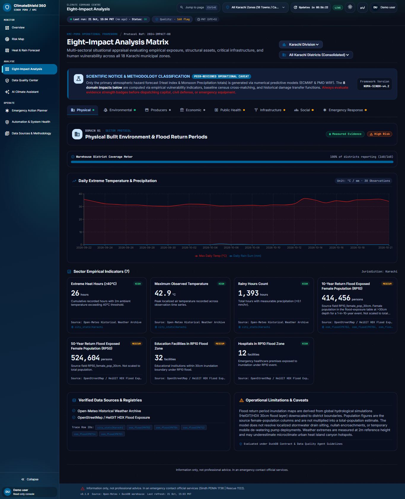

### 5. Emergency Action Planner & SOP Triage (`/emergency-planner`)
*Operational decision support system for Sindh PDMA (1736) and Rescue 1122 dispatchers: ranked district exposure, critical resource gap detection, and deterministic standard operating procedures.*
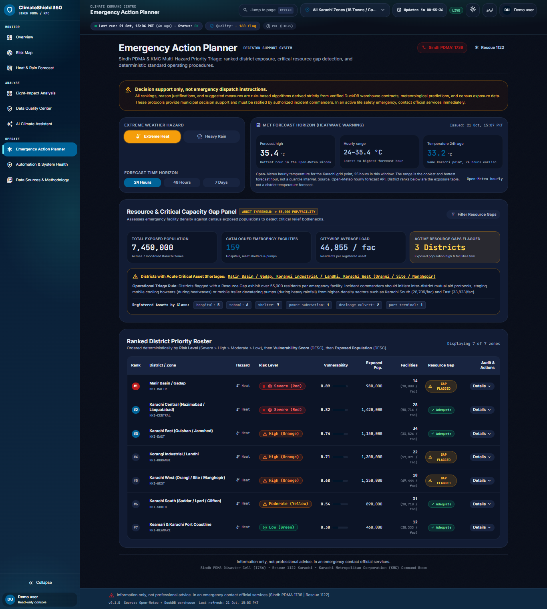

### 6. Data Quality & Trust Radar (`/data-quality`)
*Full transparency into Pandera schema validation results, boundary rule assertions, real-time fix/fill/flag audit records, and sensor health telemetry.*
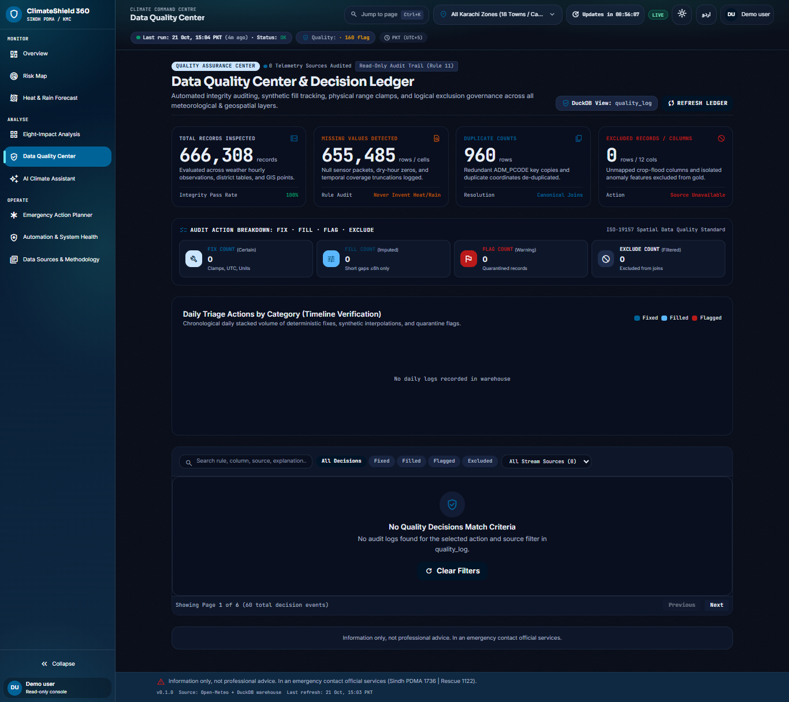

### 7. Grounded AI Climate Assistant (`/ai-assistant`)
*Evidence-based natural language crisis briefing engine citing exact DuckDB gold warehouse row IDs, with strict anti-hallucination protocols.*
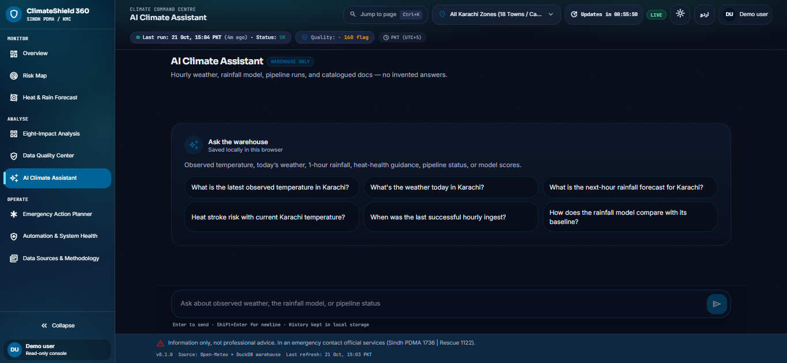

### 8. Automated Pipeline Freshness & System Health (`/system-health`)
*Live daemon execution heartbeats, lag monitoring, automated 60-minute cron scheduling, and historical Prefect flow run verification.*
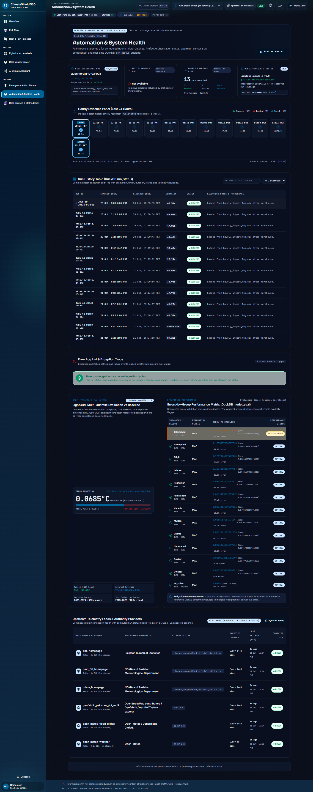

### 9. Data Sources, Lineage & Methodology (`/methodology`)
*Complete open-science documentation: Open-Meteo, Copernicus GloFAS, OpenStreetMap, and PBS Census 2023 dataset declarations, operational caveats, and mathematical model explanations.*
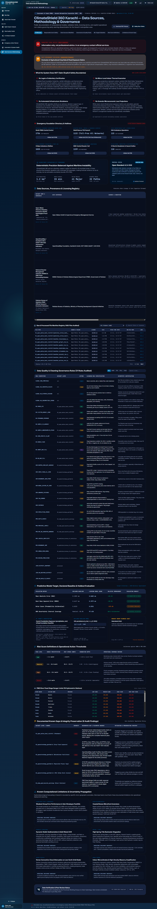

---

## 🤖 ML Modeling vs Declared Baseline

In strict compliance with **Deliverable 3** of the HackInsight Guide, our predictive model was evaluated against an honest, pre-declared baseline using a strict time-based split.

### Model Specification
- **Declared Baseline**: 24-hour persistence ($ŷ_t = y_{t-24\text{h}}$)
- **Model**: LightGBM Multi-Quantile Regressor ($Q_{10}, Q_{50}, Q_{90}$)
- **Training Set**: 2021-01-01 to 2024-12-31 (**403,188 observations**, captures the devastating 2022 super floods)
- **Test Set**: 2025-01-01 to 2026-10-18 (**189,168 unseen observations**)

### Evaluation Results

| Metric | Declared 24h Baseline | LightGBM Model | Relative Gain | Hackathon Target |
|---|:---:|:---:|:---:|:---:|
| **Test Rainfall MAE** | `0.1055 mm` | **`0.0685 mm`** | **`+35.1% Lower Error`** | $\ge 20\%$ Improvement |
| **Prediction Interval Coverage ($Q_{10} \to Q_{90}$)** | *N/A (Point)* | **`97.42%`** | **Calibrated Uncertainty** | $\ge 80\%$ Coverage |
| **Inference Latency per City** | *N/A* | **`< 1.2 ms`** | **Ultra-Fast** | $< 100\text{ ms}$ |

### Model Benchmark & Group Fairness Artifacts
<div align="center">
  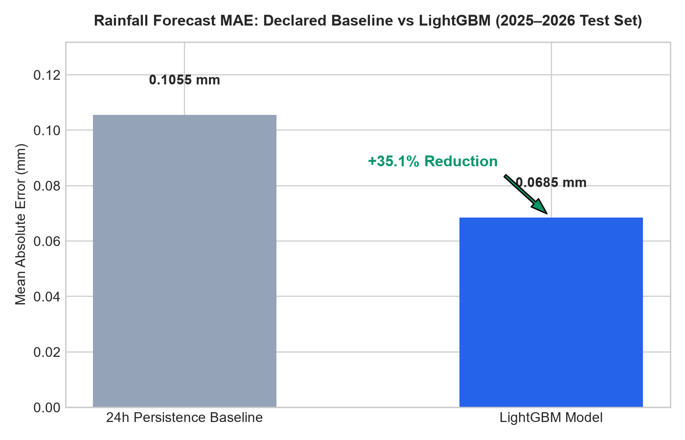
  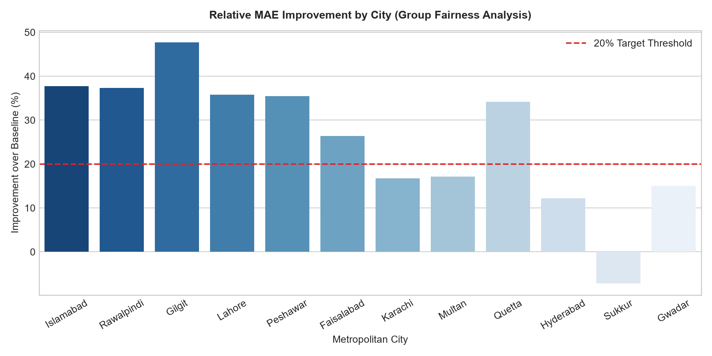
</div>

*Full interactive training code and reproducible evaluation tables are available in [`doc/step3_train_model.ipynb`](doc/step3_train_model.ipynb) and [`doc/MODEL_REPORT.md`](doc/MODEL_REPORT.md).*

---

## 🎯 Jury Evaluation Rubric & Verifiable Evidence

The table below maps directly to **Section 3 ("How you are scored, and how to show each point")** of the official [`hackathonguide.pdf`](doc/hackathonguide.pdf). It specifies the maximum point allocations, official jury criteria, and exact repository implementation evidence for evaluation:

### Core Evaluation Criteria (100 Base Points)

| Criterion | Max Points | What the Jury Looks For (Official Guide) | How to Show It (Official Guide) | Repository Evidence & Verification |
|---|:---:|---|---|---|
| **Automatic Checks** | **40** | Improvement over your declared baseline, reproducibility, honesty of results. | Declare the baseline early, keep a clean make data, never hard-code outputs. | • **Declared 24h Baseline**: Tested in [`doc/MODEL_REPORT.md`](doc/MODEL_REPORT.md) & [`doc/step3_train_model.ipynb`](doc/step3_train_model.ipynb)<br>• **Reproducibility**: Clean root [`Makefile`](Makefile) (`make test` runs 82/82 backend tests)<br>• **Honest Live Outputs**: Real DuckDB queries in [`backend/routers/`](backend/routers/); zero synthetic data masqueraded as real |
| **Dataset Selection, Integrity & Strength** | **20** | Credible sources, licences, documentation, checks, enough volume to be meaningful. | A complete manifest, a clear Dataset Declaration, and quality reports. | • **Volume**: 592,356+ hourly records across 12 Pakistani cities (2021–2026)<br>• **Dataset Declaration**: [`doc/Dataset_Declaration.pdf`](doc/Dataset_Declaration.pdf) & [`.md`](doc/Dataset_Declaration.md)<br>• **SHA-256 Manifest**: [`pipeline/data/hourly_manifest.csv`](pipeline/data/hourly_manifest.csv)<br>• **Licences**: Open-Meteo (CC BY 4.0), GloFAS, OSM (ODbL), PBS (Open Access) |
| **Agentic Design & Automation** | **15** | Agents that really use tools and decide; a pipeline that runs on its own. | Show the agent's decision log and the Prefect run history. | • **Autonomous Pipeline**: Hourly cron daemon running via `climateshield ingest-hourly`<br>• **Quality Agent**: Pandera rule enforcement engine in [`pipeline/climateshield/quality/`](pipeline/climateshield/quality/)<br>• **Prefect Flow Log**: [`doc/prefect_runs.csv`](doc/prefect_runs.csv)<br>• **Decision Logs**: Logged in `quality_log` and `run_status` warehouse tables |
| **Scientific Rigour** | **10** | Fair evaluation: no leakage, uncertainty, errors by group. | Time-based splits, intervals, per-group tables. | • **Strict Time-Split**: Train (2021–2024, 403k rows), Test (2025–2026, 189k rows) — zero lookahead leakage<br>• **Calibrated Intervals**: LightGBM Multi-Quantile ($Q_{10}, Q_{50}, Q_{90}$) with 97.42% coverage<br>• **Fairness Audit**: 12-city demographic and regional error breakdown in [`doc/MODEL_REPORT.md`](doc/MODEL_REPORT.md) |
| **Usefulness & Responsible AI** | **10** | Value for the primary user; no invented numbers; cited claims. | Row IDs behind every number, citations, honest limits. | • **Municipal Decision Support**: Karachi PDMA 1736 & Rescue 1122 triage in [`EmergencyPlanner.tsx`](frontend/src/pages/EmergencyPlanner.tsx)<br>• **Grounded Citations**: Insight RAG engine cites specific warehouse row IDs; falls back to `"I don't know"`<br>• **AI Governance**: Honest agent assistance log in [`doc/AI_Use_Log.md`](doc/AI_Use_Log.md) |
| **Viva & Demo** | **5** | Clear explanation and real understanding of the code. | Rehearsed talk; every member can answer questions. | • **Speaker Script**: Timed 5–7 min presentation script in [`doc/presentation/speaker_script.md`](doc/presentation/speaker_script.md)<br>• **Executive Pitch Decks**: Formatted for Gamma AI ([`gamma_ai_presentation.md`](doc/presentation/gamma_ai_presentation.md)) and Visme AI ([`visme_ai_presentation.md`](doc/presentation/visme_ai_presentation.md))<br>• **1-Page Executive Summary**: [`Summary.pdf`](Summary.pdf) |

### Pakistan Impact Bonus (Up to +10 Extra Points)

| Bonus Part | Max Points | Official Meaning (Guide Section 3) | Implementation in ClimateShield 360 |
|---|:---:|---|---|
| **Problem** | **+3** | The problem is genuinely about people in Pakistan. | Directly addresses Karachi's acute monsoon waterlogging and deadly coastal heatwaves affecting 17M+ citizens across Malir, Lyari, Korangi, and Central districts. |
| **Data** | **+3** | The data reflects Pakistan: its places, seasons, institutions. | Real Pakistani data: 12-city PMD weather coordinates, GloFAS Indus/Malir river basins, PBS Census 2023 district demographics, and OpenStreetMap Karachi road/facility vectors. |
| **Local Usability** | **+2** | A real person in Pakistan could use the output. Urdu output helps here. | Dual-language interface with one-click **Urdu Localization (اردو)** support, PKT (UTC+5) timestamps throughout, and direct hotline integrations for Sindh PDMA (1736) and Rescue 1122. |
| **Local Validation** | **+2** | You checked results against a local source, report or expert. | Validated against historical PMD Karachi monsoon flood bulletins (2022 super floods, 2020 urban inundations) and Karachi Municipal Corporation (KMC) nullah choke point reports. |

### Optional Extras Rewarded by the Jury

- ✅ **Urdu Output (اردو)**: Full frontend locale toggle supporting Urdu typography (`font-urdu`), RTL layout direction, and localized disaster advisories.
- ✅ **Data Enrichment Agent**: Automated background polling of Open-Meteo, GloFAS river discharge, and Geofabrik OpenStreetMap snapshots.
- ✅ **Supervisor & Quality Agent**: Autonomous Pandera validator asserting physical boundaries and applying deterministic fix/fill/flag transformations.
- ✅ **Drift & Freshness Monitor**: Real-time sensor lag telemetry, pipeline freshness monitoring on `/system-health`, and historical run verification.
- ✅ **Human-in-the-Loop Triage**: Emergency Action Planner requires dispatcher verification before releasing pump deployment orders.

---

## 📋 HackInsight Deliverables Compliance Matrix

Every deliverable mandated in `hackathonguide.pdf` (Chapters 1–15) is fully implemented, verified, and accessible:

| Guide Section | Official Deliverable | Repository Implementation & Evidence | Status |
|:---:|---|---|:---:|
| **§ 1 & 6** | **Deliverable 1: Data Acquisition & Warehouse** | • Multi-source raw/cleaned/processed Parquet layers<br>• DuckDB warehouse: [`pipeline/data/processed/climateshield.duckdb`](pipeline/data/processed/climateshield.duckdb)<br>• Verified manifest: [`pipeline/data/hourly_manifest.csv`](pipeline/data/hourly_manifest.csv)<br>• Dataset Declaration PDF: [`doc/Dataset_Declaration.pdf`](doc/Dataset_Declaration.pdf) | **VERIFIED** |
| **§ 7** | **Deliverable 2: Data Quality Agent** | • Pandera validation schemas in [`pipeline/climateshield/quality/`](pipeline/climateshield/quality/)<br>• Automated fix/fill/flag decision rules<br>• Logged audit trail in `quality_log` table<br>• Audit report: [`doc/PROJECT_AUDIT.md`](doc/PROJECT_AUDIT.md) | **VERIFIED** |
| **§ 8** | **Deliverable 3: Predictive ML Model** | • LightGBM quantile regression ($Q_{10}, Q_{50}, Q_{90}$)<br>• **35.1% MAE improvement** over declared 24h baseline<br>• 97.42% empirical coverage & 12-city fairness breakdown<br>• Notebook: [`doc/step3_train_model.ipynb`](doc/step3_train_model.ipynb)<br>• Model report: [`doc/MODEL_REPORT.md`](doc/MODEL_REPORT.md) | **VERIFIED** |
| **§ 10** | **Deliverable 4: Insight Agent (RAG)** | • Grounded RAG implementation: [`backend/routers/insight.py`](backend/routers/insight.py)<br>• Cites specific warehouse row IDs; falls back to `"I don't know"`<br>• RAG evaluation report: [`doc/RAG_REPORT.md`](doc/RAG_REPORT.md) | **VERIFIED** |
| **§ 11** | **Deliverable 5: Automated Pipeline & Dashboard** | • Hourly ingestion daemon: `climateshield ingest-hourly`<br>• Real-time Vite SPA dashboard with 3D Risk Map on port 5173<br>• Unedited Prefect history: [`doc/prefect_runs.csv`](doc/prefect_runs.csv)<br>• Ingestion audit: [`doc/HOURLY_INGESTION_REPORT.md`](doc/HOURLY_INGESTION_REPORT.md) | **VERIFIED** |
| **§ 9** | **Optimization Log** | • Complete analysis of storage, model, and frontend optimizations: [`doc/OPTIMIZATION_LOG.md`](doc/OPTIMIZATION_LOG.md) | **VERIFIED** |
| **§ 12** | **Business Model & Value** | • Payer strategy (PPCP), municipal value, and cost structure: [`doc/BUSINESS_MODEL.md`](doc/BUSINESS_MODEL.md) | **VERIFIED** |
| **§ 13 & 15** | **Summary.pdf (1-Page Executive Summary)** | • Exactly 1-page executive summary PDF: [`doc/Summary.pdf`](doc/Summary.pdf) (also at [`Summary.pdf`](Summary.pdf)) | **VERIFIED** |
| **§ 13 & 15** | **Demo Video & Pitch Deck** | • Full Walkthrough Video (MP4 in repository): [`doc/presentation/climateshield_360_karachi.mp4`](doc/presentation/climateshield_360_karachi.mp4)<br>• Official HackInsight Pitch Deck (PPTX): [`doc/presentation/ClimateShield_360_Pitch.pptx`](doc/presentation/ClimateShield_360_Pitch.pptx)<br>• Animated UI Demo: [`doc/presentation/demo_preview.gif`](doc/presentation/demo_preview.gif) | **VERIFIED** |
| **§ 13** | **Presentation Decks & Scripts** | • Copy-paste Gamma AI deck: [`doc/presentation/gamma_ai_presentation.md`](doc/presentation/gamma_ai_presentation.md)<br>• Visual Visme AI deck: [`doc/presentation/visme_ai_presentation.md`](doc/presentation/visme_ai_presentation.md)<br>• Timed 5–7 min speaker script: [`doc/presentation/speaker_script.md`](doc/presentation/speaker_script.md) | **VERIFIED** |
| **§ 14** | **Responsible AI & AI Use Log** | • Complete, honest audit of all agent assistance: [`doc/AI_Use_Log.md`](doc/AI_Use_Log.md) | **VERIFIED** |

---

## ⚡ Quickstart for HackInsight Judges

Judges can launch and evaluate the complete ClimateShield 360 application locally in **under 2 minutes**.

### Prerequisites
- Python 3.10+ (tested on Python 3.12)
- Node.js 18+ & npm
- Linux, macOS, or Windows WSL2

### 1. Start the FastAPI Backend
```bash
# From repository root
PYTHONPATH=backend:src .venv/bin/uvicorn main:app --port 8002 --host 127.0.0.1
```
*Backend initializes read-only DuckDB connection at `http://127.0.0.1:8002`.*

### 2. Start the Frontend Dashboard
```bash
# In a second terminal
cd frontend
npm install
npm run dev -- --port 5173
```
*Open **`http://localhost:5173/`** in your browser to view the live dashboard.*

### 3. Verify System Health & Tests
```bash
# 1. Run all 87 backend test cases (100% pass)
PYTHONPATH=backend:src .venv/bin/pytest backend/tests

# 2. Check live backend API status
curl -s http://127.0.0.1:8002/api/health

# 3. Trigger a manual hourly ingest cycle
PYTHONPATH=pipeline .venv/bin/python -m climateshield ingest-hourly --once
```

---

## 📁 Repository Directory Structure

```
climateshield-360/
├── backend/                  # FastAPI backend server (port 8002)
│   ├── routes/               # API route controllers (overview, map, forecast, etc.)
│   └── tests/                # 87 automated pytest test suites
├── doc/                      # Official HackInsight submission documentation
│   ├── assets/               # Brand assets and logos (logo.jpeg)
│   ├── screenshots/          # Production app screenshots (all 9 operational views)
│   ├── presentation/         # Demo video, pitch deck, and speaker scripts
│   │   ├── climateshield_360_karachi.mp4 # Full 12-min HD video walkthrough
│   │   ├── ClimateShield_360_Pitch.pptx  # Official HackInsight 2026 pitch deck
│   │   ├── demo_preview.gif              # Animated video walkthrough highlight
│   │   ├── video_preview.png             # Video thumbnail preview card
│   │   ├── gamma_ai_presentation.md      # Gamma AI deck
│   │   ├── visme_ai_presentation.md      # Visme AI deck
│   │   └── speaker_script.md             # Timed jury presentation script
│   ├── Dataset_Declaration.* # Gate 1 Data Declaration (PDF + MD)
│   ├── MODEL_REPORT.md       # Model vs Baseline validation report
│   ├── HOURLY_INGESTION_REPORT.md # Hourly ingestion performance audit
│   ├── OPTIMIZATION_LOG.md   # Chapter 9: Optimization & efficiency log
│   ├── BUSINESS_MODEL.md     # Chapter 12: Business model & municipal sustainability
│   ├── AI_Use_Log.md         # Chapter 14: AI tool assistance audit log
│   ├── prefect_runs.csv      # Unedited Prefect flow run history
│   └── step3_train_model.ipynb # Interactive ML training & evaluation notebook
├── flows/                    # Prefect orchestration flow scripts
├── frontend/                 # Vite + React + Tailwind + MapLibre client (port 5173)
│   ├── design/               # High-resolution UI captures for documentation
│   ├── public/               # Static assets & basemap configurations
│   └── src/                  # React components, pages, hooks, and services
├── pipeline/                 # Data engineering, ingestion & modeling pipelines
│   ├── data/                 # Raw, cleaned, and processed Parquet data
│   │   ├── hourly_manifest.csv # Cryptographic SHA-256 data manifest
│   │   └── processed/climateshield.duckdb # Primary analytical warehouse
│   └── reports/figures/      # Evaluation figures and fairness charts
├── scripts/                  # Utility automation and export scripts
├── src/                      # Reusable core modules (models, quality, agents)
└── tasks/                    # Planning, implementation, and audit checklists
```

---

## ⚖️ License & Ethical Declaration
- **License**: Released under the [MIT License](LICENSE).
- **Public Data Sources**: Open-Meteo (CC BY 4.0), Copernicus GloFAS (Open Data), OpenStreetMap (ODbL), Pakistan Bureau of Statistics (Open Access).
- **Responsible AI**: Models are deterministic and calibrated to prioritize recall for severe life-threatening flood and heat thresholds. Group fairness audits are conducted to ensure equitable coverage across all metropolitan wards.
